# Informe final — Predicción de incumplimiento de préstamos en Lending Club

**Curso:** Machine Learning — Proyecto final · **Grupo 4**

- Abigail Jaslin Cabanillas Ventocilla | 202510438
- Mia Alexie Wood De la Fuente Chávez | 202410085
- Mia Dayhana Hurtado Vite | 202410245

Todas las cifras de este informe se regeneran con `python -m src.train` y
`python -m src.eda`, y salen de `outputs/metrics.json`, `outputs/cv_results.csv`
y `outputs/segment_errors.csv`. Las figuras están en `reports/figures/`.

---

## 1. Resumen ejecutivo

Construimos un modelo que estima la probabilidad de que un préstamo personal de
Lending Club termine en **incumplimiento** (charged off, default o mora > 30
días). Usa **solo información disponible cuando se decide aprobar el
préstamo**, lo que elimina las decenas de columnas con *leakage* del dataset.

- **Datos:** 1 369 566 préstamos con resultado observado (2007–2018), del
  archivo completo de 2.26 M filas.
- **Validación:** partición **temporal**. Se entrena con los préstamos emitidos
  hasta 2016-10 (1.09 M) y se evalúa una sola vez con los emitidos entre 2016-11
  y 2018-12 (280 mil). Los hiperparámetros, el umbral y el modelo final se
  eligieron sin mirar el test.
- **Modelos:** dummy, regresión logística (baseline y ajustada), Random Forest y
  HistGradientBoosting.
- **Resultado:** el modelo final (**HistGradientBoosting**) alcanza **ROC-AUC
  0.7025**, **PR-AUC 0.438** y **KS 0.296** en el test out-of-time. El baseline
  logístico obtiene 0.6959 / 0.4305 / 0.2847. La mejora es **pequeña pero
  estadísticamente significativa** (ΔAUC +0.0066, IC95% bootstrap [+0.0060, +0.0072]).
- **Hallazgo principal:** las cuatro familias de modelos convergen en ≈0.70 de
  AUC. El límite está en **la información disponible al originar el préstamo**,
  no en el algoritmo. Gran parte del poder predictivo viene del `sub_grade` que
  asigna el propio Lending Club.
- **Advertencias:** por la deriva temporal, el modelo **subestima el riesgo**
  en ≈5 puntos (probabilidad media predicha de 0.21 frente a 0.263 observado) y
  marca más a inquilinos y a personas de ingresos bajos. Antes de usarlo hay que
  recalibrarlo y fijar el umbral con costos reales.

## 2. Descripción del problema

**Pregunta predictiva.** Dado un solicitante y las condiciones del préstamo en
el momento en que Lending Club decide aprobarlo y fijar su tasa, ¿el préstamo
terminará en incumplimiento en lugar de pagarse por completo?

- **Tipo:** clasificación binaria supervisada.
- **Unidad de predicción:** un préstamo individual en su originación.
- **Variable objetivo** `mal_desempeno`:
  - 1 = `Charged Off`, `Default`, `Late (31-120 days)` y su variante "Does not
    meet the credit policy".
  - 0 = `Fully Paid` y su variante.
  - Se **excluyen** `Current`, `In Grace Period`, `Late (16-30 days)` e
    `Issued`, porque su resultado todavía no es observable.

**Relevancia.** Un score de riesgo al originar sirve para fijar el precio
(tasa) según el riesgo, para priorizar la revisión manual de solicitudes y para
que los inversionistas de la plataforma elijan préstamos. El error que cuesta
más es el falso negativo (prestar a quien no paga). Rechazar a buenos pagadores
también tiene un costo: margen perdido y exclusión financiera.

## 3. Descripción del dataset

| Aspecto | Detalle |
|---|---|
| Fuente | Lending Club, mirror de Kaggle `wordsforthewise/lending-club`, archivo `accepted_2007_to_2018Q4.csv` |
| Licencia / acceso | Datos públicos de LC; Kaggle requiere una cuenta gratuita; uso académico sin restricciones |
| Tamaño | 2 260 701 préstamos × 151 columnas (≈1.6 GB sin comprimir) |
| Con resultado observado | 1 369 566 préstamos (61%) |
| Columnas usadas | 27 columnas de originación (lista blanca en `src/data.py`) |
| Periodo | Emisiones de 2007-06 a 2018-12 |
| Desbalance | 19.9% de default en train y 26.3% en test |

**Por qué es complejo:** alto volumen, desbalance de clases, faltantes no
aleatorios, deriva temporal fuerte, categóricas de alta cardinalidad y, sobre
todo, un **riesgo de leakage severo**. Más de 30 columnas se generan después de
otorgar el crédito.

**Decisión de muestreo.** La entrega previa usó una muestra del 8%. La entrega
final usa el **dataset completo**: se lee el `.csv.gz` cargando solo las 27
columnas necesarias, con un pico de ≈1.9 GB de RAM. La búsqueda de
hiperparámetros usa una submuestra aleatoria del 25% del train (272 mil
préstamos) por costo computacional. El reentrenamiento final y la evaluación
usan todos los datos.

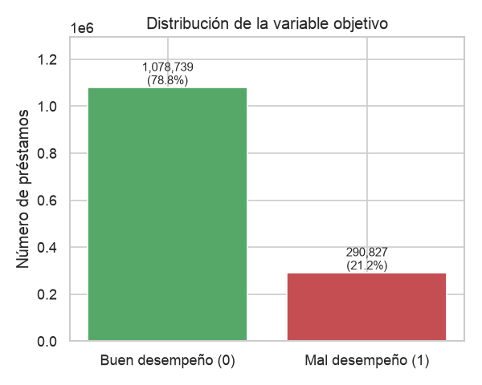

## 4. Limpieza y preparación de datos

Todo está implementado en `src/data.py` y `src/features.py`. Las
transformaciones que se ajustan con datos se ajustan **solo con train**.

| Problema | Tratamiento | Justificación |
|---|---|---|
| **Leakage** | Lista blanca de 27 columnas de originación; lista negra documentada (`LEAKAGE_COLUMNS`: pagos, recuperaciones, FICO actualizado, hardship/settlement, montos fondeados) | Esas columnas ni siquiera se cargan |
| Préstamos sin resultado | Se excluyen `Current`, `In Grace Period`, `Late (16-30)` | Su etiqueta aún no existe |
| `fico_range_low/high` (corr. 1.00) | Se combinan en `fico_avg` | Redundancia |
| `installment` (corr. 0.95 con `loan_amnt`) | Se descarta | Es casi una función de monto, tasa y plazo |
| `earliest_cr_line` | → `credit_hist_months` (meses de historial al emitir el préstamo) | Feature temporal útil sin leakage |
| Outliers de `annual_inc` (hasta 11 M) | Recorte al percentil 99 de train (250 000) | Ingresos autodeclarados extremos |
| `dti` imposibles (hasta 999) | Recorte a min(p99 de train, 60) = 37.9 | Errores de carga |
| `emp_length` faltante (5.9%) | Categoría propia `"Desconocido"` | La ausencia es informativa (35% de default) |
| Faltantes residuales (< 0.1%) | Mediana (numéricas) / moda (categóricas) dentro del `Pipeline` | Se ajusta en cada fold |
| Categóricas | One-hot (modelos lineales) / codificación ordinal y categóricas nativas (árboles) | Cada familia usa la codificación adecuada |
| `addr_state`, `emp_title`, `title` | Se excluyen | Alta cardinalidad y riesgo de discriminación geográfica |

Resultado: **23 variables de entrada** (14 numéricas y 9 categóricas).

## 5. Análisis exploratorio

| | |
|---|---|
| 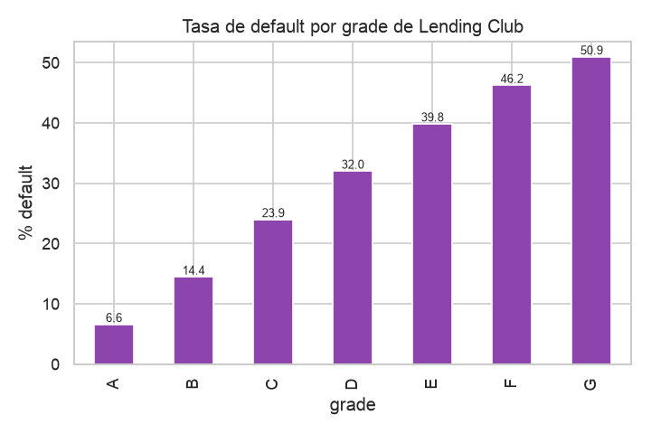 | 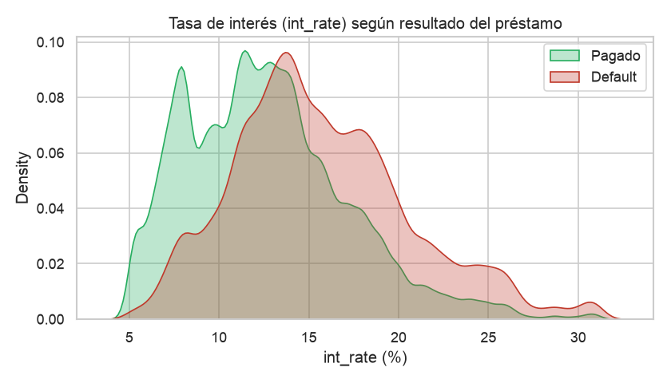 |
| 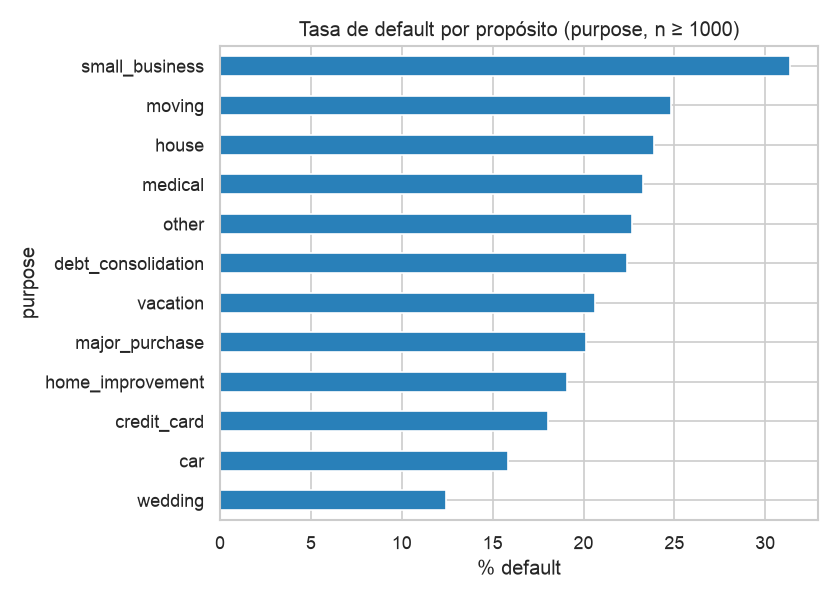 | 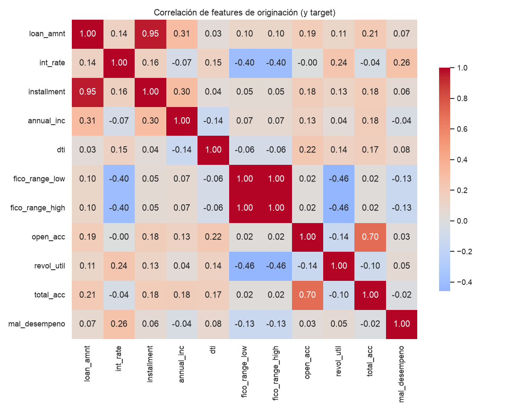 |

- La tasa de default crece de forma **monótona con el grade**, de A a G. Es la
  señal más fuerte y es legítima, porque LC asigna el grade al originar el préstamo.
- `int_rate` es la numérica más correlacionada con el objetivo. Le siguen el
  FICO (correlación negativa) y el DTI.
- Por propósito, `small_business` es el de mayor riesgo (31%) y
  `wedding`, `car` y `credit_card` los de menor (12–18%).

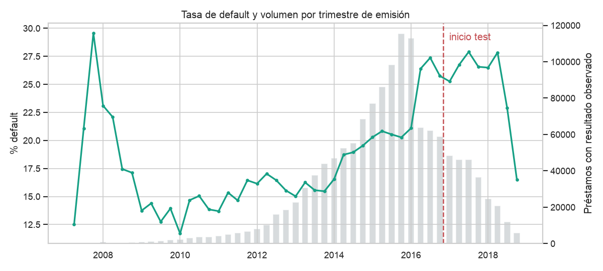

- **Deriva temporal fuerte:** la tasa de default cae de ~20% a ~12–17% entre
  2009 y 2013 y sube a ~26–28% en 2016–2018. La caída final de 2018 es un
  **sesgo de resolución**: de los préstamos recientes solo se conoce el
  resultado de los que terminaron rápido.
- Esto motiva una **partición temporal** en lugar de aleatoria.

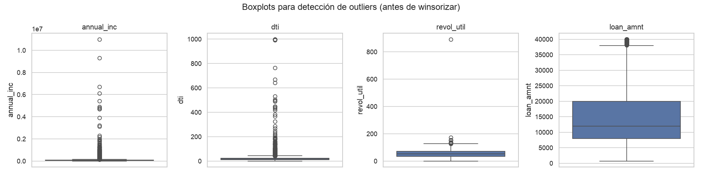

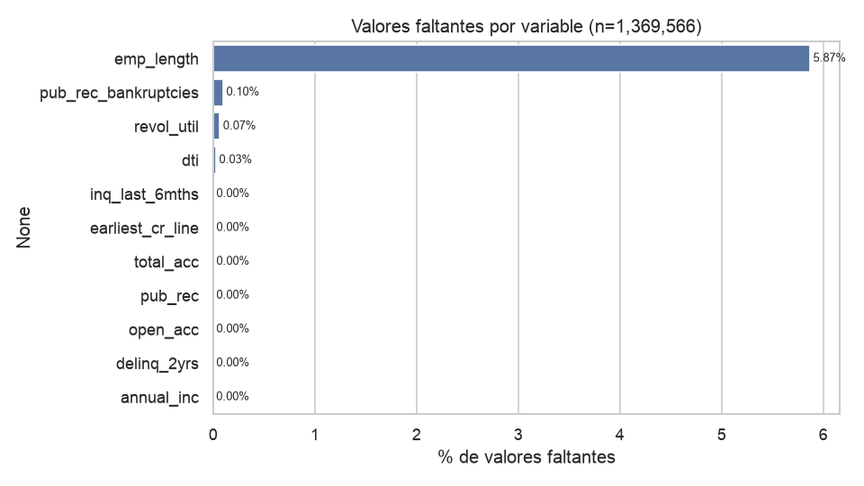

## 6. Estrategia de partición y validación

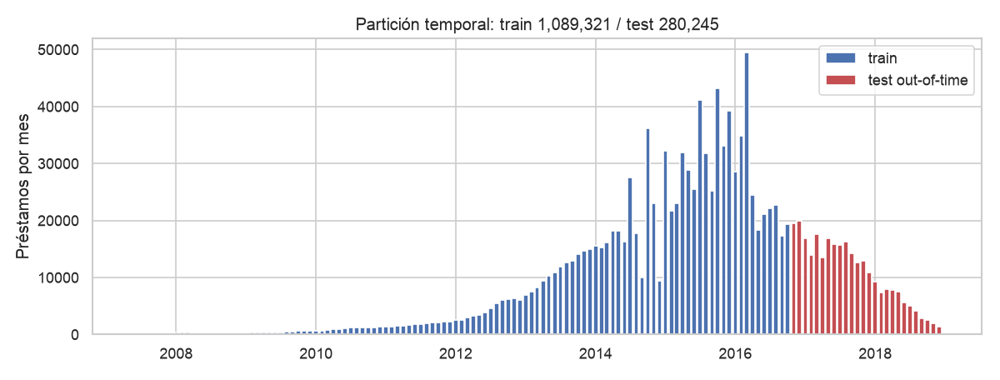

| Conjunto | Uso | Préstamos |
|---|---|---|
| **Train** (2007-06 a 2016-10) | Ajuste de transformaciones, búsqueda, umbral, entrenamiento final | 1 089 321 |
| ↳ submuestra del 25% ordenada por fecha | `TimeSeriesSplit(4)`: cada fold entrena con el pasado y valida con el futuro | 272 330 |
| ↳ bloque de selección (15% más reciente del train, 2016-03 a 2016-10) | Elección del umbral operativo | 194 770 |
| **Test out-of-time** (2016-11 a 2018-12) | Evaluación final, **una sola vez** | 280 245 |

**Reglas de decisión fijadas antes de evaluar:**
- Modelo final = mayor ROC-AUC medio en la CV temporal.
- Umbral = el que maximiza F1 en el bloque de selección.

**Métricas** (no se usa accuracy, porque predecir siempre "paga" daría 74%):
- **Principal: ROC-AUC.** Mide la capacidad de ordenar por riesgo y no
  depende del umbral.
- **Secundarias: PR-AUC y KS.** Se centran en la clase minoritaria. El KS es
  el estándar en scoring crediticio.
- **Complementarias:** Brier (calibración) y precision, recall, F1 y % de
  préstamos marcados al umbral operativo.

## 7. Baselines

| Modelo | ROC-AUC test | PR-AUC | KS | Brier |
|---|---|---|---|---|
| Dummy (predice la tasa base) | 0.5000 | 0.2631 | 0.000 | 0.1979 |
| **Regresión logística baseline** (sin tuning ni balanceo, la misma de la entrega previa) | **0.6959** | **0.4305** | **0.2847** | 0.1800 |

El baseline logístico ya extrae casi toda la señal: KS de 0.28 frente a 0 del dummy y
PR-AUC 17 puntos por encima de la tasa base.
Al umbral 0.5 su recall es apenas del 4.9%: el umbral por defecto no sirve con
esta tasa base.

## 8. Modelos entrenados

Hay tres familias reales más dos referencias, todas dentro de un `Pipeline`
de scikit-learn (`src/train.py`):

| Modelo | Familia | Preprocesamiento |
|---|---|---|
| `logreg_baseline` | Lineal | Imputación + escalado + one-hot |
| `logreg_tuned` | Lineal regularizada (L2) | Igual |
| `random_forest` | Bagging de árboles (200 árboles, 30% de filas por árbol) | Imputación + codificación ordinal |
| `hist_gradient_boosting` | Boosting con categóricas nativas y early stopping | Imputación + codificación ordinal |

## 9. Búsqueda de hiperparámetros

| Modelo | Espacio | Estrategia | Mejor configuración | CV ROC-AUC |
|---|---|---|---|---|
| logreg_baseline | — | — | C=1 | 0.7182 ± 0.013 |
| logreg_tuned | `C` ∈ {0.01, 0.1, 1}, `class_weight` ∈ {None, balanced} | Grid (6) | C=0.01, balanced | 0.7186 ± 0.013 |
| random_forest | `max_depth` ∈ {10,14,18}, `min_samples_leaf` ∈ {20,100,300}, `max_features` ∈ {sqrt, 0.33}, `class_weight` | Aleatoria (6) | depth 18, leaf 20, sqrt, balanced_subsample | 0.7184 ± 0.014 |
| **hist_gradient_boosting** | `learning_rate` ∈ {0.03,0.06,0.1}, `max_leaf_nodes` ∈ {15,31,63}, `min_samples_leaf` ∈ {100,300,1000}, `l2` ∈ {0,1,10}, `class_weight` | Aleatoria (10) | lr 0.03, 15 hojas, leaf 1000, l2=1, sin balanceo | **0.7194 ± 0.014** |

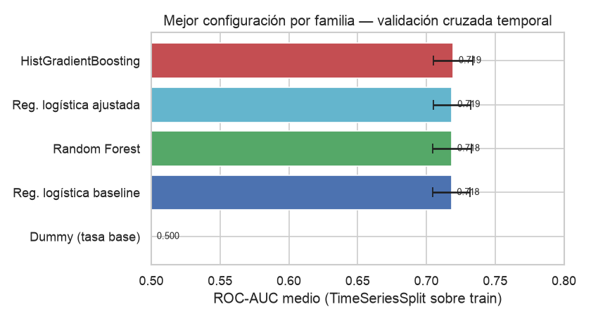

- La dispersión entre folds temporales (±0.014) es **mayor** que la diferencia
  entre familias. El periodo de tiempo pesa más que el algoritmo.
- La mejor configuración de boosting es la más **regularizada** del espacio de
  búsqueda: con una señal débil, la complejidad no ayuda.
- `class_weight="balanced"` no cambia el AUC, solo desplaza la escala de las
  probabilidades. Su umbral óptimo es ≈0.41–0.46, frente a ≈0.17 sin balanceo.

## 10. Evaluación final (test out-of-time)

| Modelo | ROC-AUC | PR-AUC | KS | Brier | Umbral | Precision | Recall | F1 | % marcados |
|---|---|---|---|---|---|---|---|---|---|
| Dummy | 0.5000 | 0.2631 | 0.000 | 0.1979 | — | — | — | — | — |
| Reg. logística baseline | 0.6959 | 0.4305 | 0.2847 | 0.1800 | 0.167 | 0.360 | 0.761 | 0.489 | 55.6% |
| Reg. logística ajustada | 0.6960 | 0.4304 | 0.2851 | 0.2203 | 0.462 | 0.367 | 0.735 | 0.489 | 52.7% |
| Random Forest | 0.6960 | 0.4295 | 0.2852 | 0.2070 | 0.406 | 0.360 | 0.761 | 0.489 | 55.6% |
| **HistGradientBoosting (final)** | **0.7025** | **0.4380** | **0.2962** | **0.1781** | 0.167 | 0.361 | **0.775** | **0.492** | 56.5% |

**Bootstrap pareado (300 réplicas), ΔROC-AUC frente al baseline:**

| Modelo | ΔAUC | IC95% |
|---|---|---|
| Reg. logística ajustada | +0.0001 | [0.0000, 0.0001] |
| Random Forest | +0.0001 | [−0.0005, +0.0007] |
| **HistGradientBoosting** | **+0.0066** | **[+0.0060, +0.0072]** |

| | |
|---|---|
| 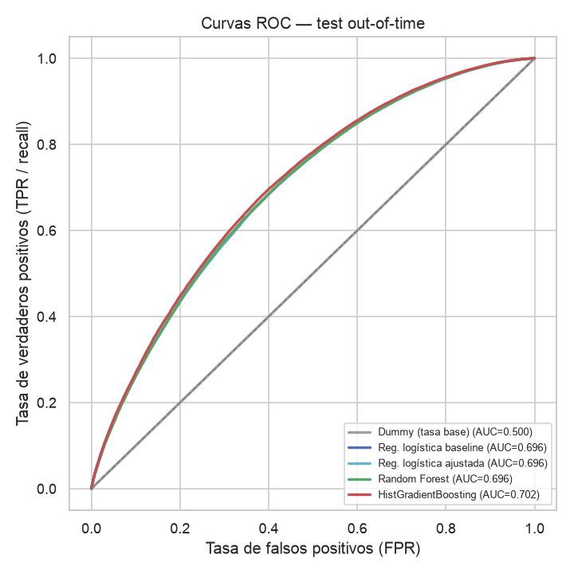 | 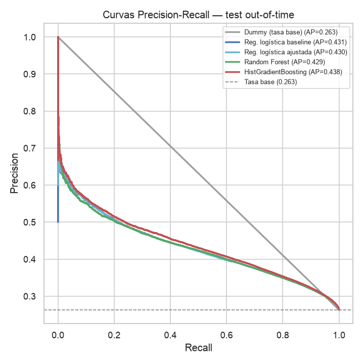 |
| 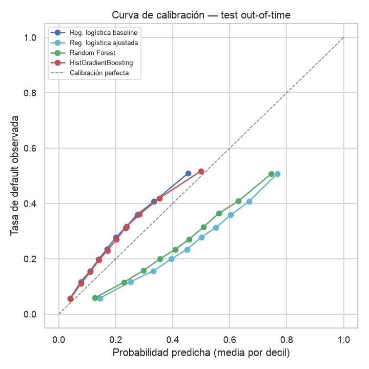 | 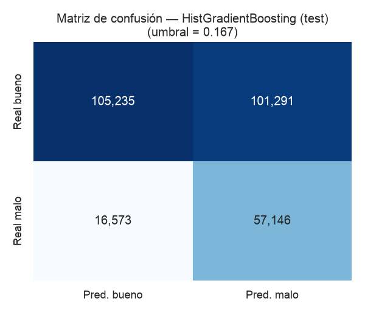 |

**Lectura:**
- El orden de los modelos en el test **coincide con el de la CV temporal**.
  Solo el boosting mejora al baseline de forma significativa.
- La mejora es modesta: +0.007 de AUC, +0.008 de PR-AUC y +0.012 de KS.
- **Calibración:** el boosting tiene el mejor Brier, pero subestima el riesgo
  del test (probabilidad media de 0.21 frente a 0.263 real) por la deriva
  temporal. Los modelos con `class_weight` balanceado sobreestiman mucho (media
  ≈0.43–0.47), así que sus salidas no pueden leerse como probabilidades.
- Al umbral operativo, el modelo final detecta el **77.5% de los defaults**,
  pero marca al **56.5% de los préstamos**. Sirve más como score para fijar
  precios o priorizar revisión que como regla automática de rechazo.
- **Ranking por deciles:** la tasa de default sube de forma monótona del 5.5%
  (decil 1) al 51.7% (decil 10). El 30% de mayor score concentra el 49% de los
  defaults.

## 11. Interpretación

| | |
|---|---|
| 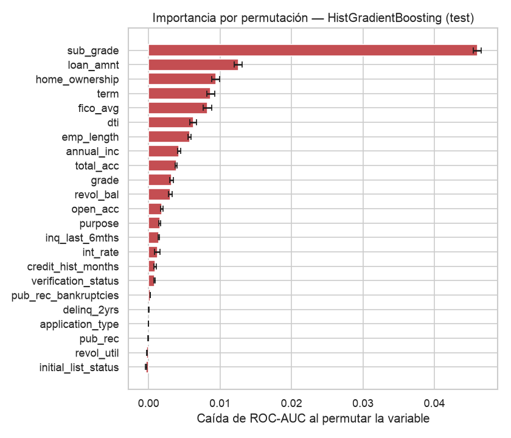 | 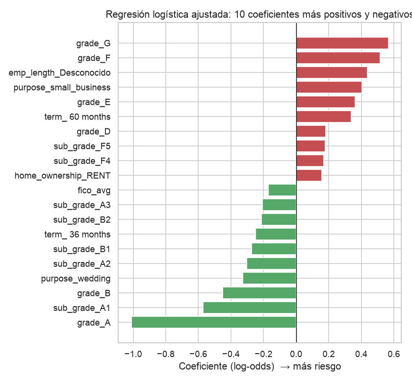 |

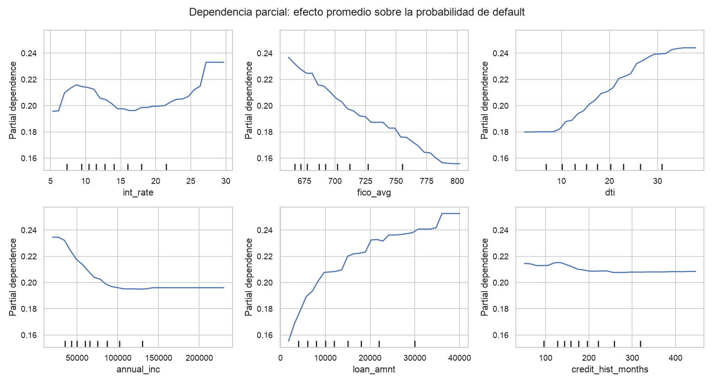

- **Importancia por permutación** (caída del AUC en el test):
  - `sub_grade` domina con −0.046. Le siguen `loan_amnt`, `home_ownership`,
    `term`, `fico_avg` y `dti`.
  - `int_rate` y `grade` salen bajas porque son **redundantes con
    `sub_grade`** (LC fija la tasa según el sub-grade). Al permutar una sola,
    la información sigue disponible en las otras.
- **Efectos (dependencia parcial):**
  - El riesgo baja con el FICO y con el ingreso hasta unos 100k.
  - Sube con el DTI, con el monto y en los préstamos a 60 meses.
  - La antigüedad crediticia casi no aporta.
- La **regresión logística** coincide en la dirección de todos los efectos
  principales. Los dos modelos aprenden relaciones económicamente sensatas.
- Implicación: el modelo **refina el scoring de Lending Club** (`sub_grade`)
  con variables del solicitante, más que reemplazarlo.

## 12. Análisis de errores

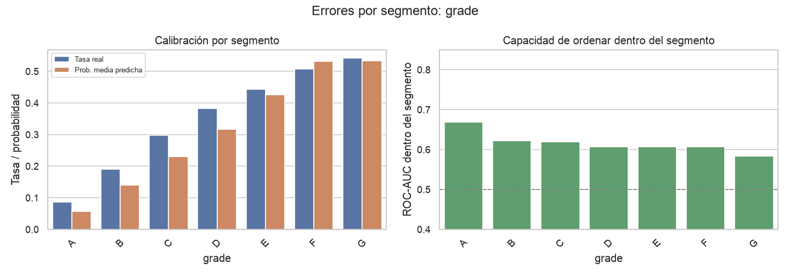

| Segmento | Hallazgo |
|---|---|
| **Grade** | Dentro de cada grade el AUC cae a 0.58–0.67. Al umbral, el modelo marca 0.2% de los préstamos A y 80–100% de los C–G, así que en la práctica funciona como una regla por grade |
| **Plazo** | En 60 meses: más riesgo real (36.6% frente a 22.9%), peor AUC (0.66 frente a 0.70) y 90% de préstamos marcados |
| **Tiempo** | El AUC por trimestre del test es estable (0.68–0.71): el ranking no se degrada en 2 años. La calibración sí se degrada |
| **Calibración por grupo** | Hay subestimación casi en todas partes. Es mayor en `small_business` (−14.6 pts), `emp_length` desconocido (−8.6), inquilinos (−7.6), `Verified` (−7.1) y el quintil de ingreso bajo (−6.6) |

**Casos problemáticos:**
- **Falsos negativos:** el 79% son grade A–B, solo el 6% es a 60 meses, con
  tasa mediana de 10.5% y FICO de 702. Su perfil es casi idéntico al de los
  buenos pagadores. Con datos de originación son **indistinguibles**; los
  causan eventos posteriores al préstamo.
- **Falsos positivos:** su perfil es el de un préstamo riesgoso (tasa de 15.5%,
  38% a 60 meses) que terminó pagándose.

El techo de ≈0.70 de AUC es de **información**, no de modelado.

## 13. Riesgos éticos, sesgos y limitaciones

- **Sesgo de selección (*reject inference*):** solo se observan préstamos
  aprobados por LC. El modelo no generaliza a los solicitantes rechazados.
- **Sesgo de resolución:** excluir los préstamos `Current` sobrerrepresenta en
  los periodos recientes los préstamos que terminaron pronto. Por eso la tasa del
  test (26.3%) es mayor que la del train (19.9%) y la de 2018Q4 es anómalamente baja.
- **Deriva temporal:** el modelo subestima el riesgo en ≈5 puntos en 2017–2018.
  Habría que recalibrarlo periódicamente.
- **Equidad y proxies:**
  - No hay atributos protegidos en los datos, pero `home_ownership`, el
    ingreso y `emp_length` pueden funcionar como proxies socioeconómicos.
  - El modelo marca al 65% de los inquilinos frente al 49% de los propietarios
    con hipoteca, y al 69% del quintil de ingreso bajo frente al 45% del alto.
  - Esas diferencias reflejan tasas de default reales distintas, no un sesgo
    introducido por el modelo. Aun así, una regla automática restringiría el
    crédito a grupos de menores recursos de forma desproporcionada.
  - Además, el modelo subestima **más** el riesgo justamente en esos grupos.
- **Ausencia informativa:** penalizar `emp_length` desconocido (35% de
  default) puede afectar a trabajadores independientes o informales.
- `addr_state` se excluyó para evitar discriminación geográfica (*redlining*).
- **Limitaciones adicionales:**
  - Ingresos y empleo son autodeclarados.
  - El modelo depende del `sub_grade`, que es la salida del modelo de LC.
  - No se modela la pérdida esperada (recuperación, momento del default).
  - El umbral maximiza F1 y no costos reales.

## 14. Trabajo futuro

1. **Recalibración** (isotónica o Platt) con los préstamos más recientes del
   train, y monitoreo de la deriva (PSI) por trimestre.
2. **Umbral por costos:** una matriz de costos con la pérdida esperada por
   default y el margen por préstamo bueno, o una política por bandas de riesgo
   en lugar de un corte binario.
3. **Etiqueta sin sesgo de resolución:** restringir el análisis a cohortes
   cuyo plazo completo ya venció (por ejemplo, préstamos a 36 meses emitidos
   hasta 2015), o modelar la supervivencia (tiempo hasta el default).
4. **Más información:** columnas de buró adicionales disponibles al originar
   (`mths_since_last_delinq`, `bc_util`, `num_tl_*`, con su ausencia
   informativa) y texto de `emp_title` agrupado.
5. **Modelo sin `sub_grade`:** medir cuánto aporta un modelo propio frente al
   scoring de LC.
6. **Auditoría de equidad formal:** paridad de tasas de marcado y de error por
   grupo, y restricciones de equidad si la política de negocio lo exige.

## 15. Instrucciones de reproducción

```bash
pip install -r requirements.txt
# 1. Descargar accepted_2007_to_2018Q4.csv.gz de Kaggle y dejarlo en data/ (ver data/README.md)
# 2. Entrenamiento completo (~15 min en un portátil de 8 GB / 8 núcleos)
python -m src.train --data data/accepted_2007_to_2018Q4.csv.gz
# 3. Figuras exploratorias sobre el dataset completo
python -m src.eda --data data/accepted_2007_to_2018Q4.csv.gz
# 4. Notebooks de análisis (leen outputs/; no reentrenan)
jupyter nbconvert --to notebook --execute --inplace notebooks/03_modelos.ipynb
jupyter nbconvert --to notebook --execute --inplace notebooks/04_analisis_errores.ipynb
```

- La semilla fija es `RANDOM_SEED = 42` en el muestreo, la CV, los modelos y el
  bootstrap.
- `python -m src.train --quick` corre una prueba de humo de ≈3 min con el 5% de
  los datos.
- **Salidas:**
  - `outputs/metrics.json`: configuración, CV, umbrales y métricas de test de
    todos los modelos.
  - `outputs/cv_results.csv` y `outputs/cv_all_trials.csv`.
  - `outputs/segment_errors.csv`, `outputs/permutation_importance.csv` y
    `outputs/bootstrap_auc_vs_baseline.csv`.
  - `reports/figures/`.
